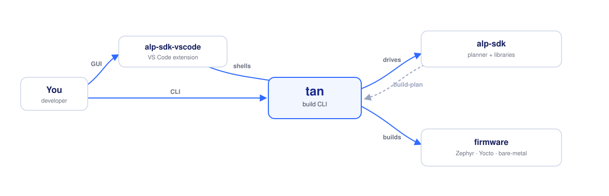
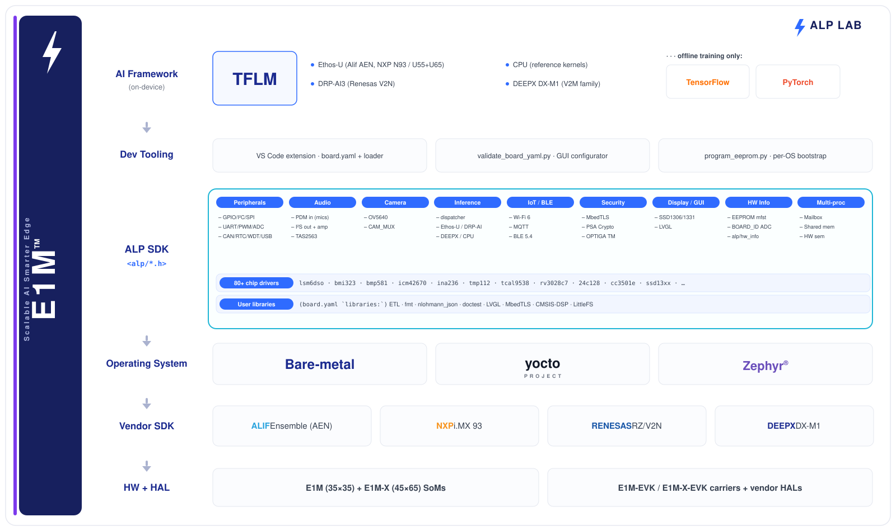

<div align="center">

# ⚡ Alp Lab

**Edge AI hardware — and the software that runs on it.**

From the open **E1M** System-on-Module standard, through **Alp Platform** —
the tested software stack that targets it — to **Signex**, our open-source
AI-first EDA tool.

[](https://github.com/alplabai/alp-platform/releases/latest)
[](https://github.com/alplabai/e1m-spec)
[](https://github.com/alplabai/alp-sdk/releases/latest)
[](https://github.com/alplabai/tan-cli/releases/latest)
[](https://github.com/alplabai/signex/releases/latest)


</div>

---

## Alp Platform — one version for the whole stack

**[Alp Platform](https://github.com/alplabai/alp-platform)** names a set of
component versions that we have built and bench-validated together on real
modules: the Alp SDK, the `tan` build CLI, the VS Code extension, and the
GD32 and CC3501E bridge firmware. Instead of matching five version numbers
by hand, you pin one platform line.

```sh
tan platform use 26.11      # newest 26.11.x
tan doctor                  # reports the platform and any off-manifest component
```

Platform versions are CalVer (`YY.M.MICRO`); the first line is **26.11**.
Each component keeps its own SemVer — the platform adds a tested set on top,
it never replaces a component version. Every release attaches its
`platform.yaml` manifest; the
[latest release](https://github.com/alplabai/alp-platform/releases/latest)
lists the exact component versions and the validated hardware.


---

## The two stacks

### Edge AI · E1M + Alp Platform

- **[E1M Standard](https://github.com/alplabai/e1m-spec)** (`E1M-STD-1.0`)
  — open, silicon-agnostic pinout + mechanical envelope for AI-capable
  Systems-on-Module in two form factors: **E1M** (35 × 35 mm, 312 pads)
  and **E1M-X** (45 × 65 mm, 496 pads). The standard fixes the universe
  of pads and which signals each may carry; silicon variants — E1M-AEN
  (Alif Ensemble), E1M-X V2N (Renesas RZ/V2N), E1M-X V2M (RZ/V2N + DEEPX
  DX-M1) — declare their routed subset in per-variant SoM manifests.
  Any vendor can ship pin-compatible modules; any product board targets
  one connector and accepts multiple SoMs.
- **[Alp SDK](https://github.com/alplabai/alp-sdk)** — unification C/C++
  firmware framework for E1M modules. A single `board.yaml` drives
  Zephyr, Yocto, and bare-metal builds across Alif Ensemble, Renesas
  RZ/V2N and DEEPX DX-M1 silicon — single-OS or heterogeneous (Zephyr +
  Yocto + bare-metal coexisting on one SoM from one declarative project).
  Ships with 80 chip drivers, ML inference dispatch (TFLite Micro →
  Ethos-U / DRP-AI / DEEPX), and runtime hardware identification from the
  on-module EEPROM manifest.
- **[tan](https://github.com/alplabai/tan-cli)** — the standalone build
  CLI that turns an Alp SDK project into firmware. One command surface
  (`tan build` / `validate` / `doctor` / `platform` / …) reads a
  `board.yaml`, plans the build, and produces a Zephyr / Yocto /
  bare-metal image end-to-end. Prebuilt binaries for Linux, macOS and
  Windows.
- **[VS Code extension](https://github.com/alplabai/alp-sdk-vscode)** —
  schema-aware `board.yaml` editing and a GUI configurator. It shells the
  **same `tan` binary**, so anything you can do in the editor you can do
  from the terminal.
- **Bridge firmware** — the on-module coprocessors:
  [gd32-bridge-firmware](https://github.com/alplabai/gd32-bridge-firmware)
  (GD32G553 I/O bridge on E1M-X) and
  [cc3501e-bridge-firmware](https://github.com/alplabai/cc3501e-bridge-firmware)
  (TI CC3501E Wi-Fi 6 + BLE on E1M-AEN). Wire contracts and host drivers
  live in the Alp SDK.

### Open EDA · Signex

- **[Signex](https://github.com/alplabai/signex)** is an open-source,
  AI-first EDA suite built in Rust with GPU-accelerated rendering and an
  Altium Designer-quality UI — schematic + PCB editor, 3D viewer,
  simulation, plugin system. Native file formats (`.snxsch`, `.snxpcb`,
  `.snxsym`, `.snxfpt`) are line-diffable in git and ~5× smaller than the
  equivalent JSON. Migrating from KiCad or Altium? The optional
  [signex-kicad-import](https://github.com/alplabai/signex-kicad-import)
  companion (GPL-3.0-or-later, distributed independently) converts
  `.kicad_sch` / `.kicad_pcb` / `.kicad_pro` one-way to Signex's native
  formats, and
  [signex-altium-import](https://github.com/alplabai/signex-altium-import)
  imports Altium Designer schematics, PCBs and libraries.
  - **Signex Community** (Apache-2.0) — full schematic + PCB editor, 3D
    viewer, simulation, plugin system. Free forever.
  - **Signex Pro** (subscription) — adds Signal AI (Claude-powered design
    copilot), real-time collaboration, and Signex 365 cloud PLM.

---

## How the toolchain fits together

You drive **one command surface**; it fans down to the SDK and out to a
firmware image. The VS Code extension is a GUI over the same `tan` binary
— nothing you can do in the editor is off-limits from the terminal.



## The Alp SDK layer stack

A `board.yaml` at the top compiles down through each layer to silicon.
Every layer is declarative and swappable — change the SoM, keep your source.



---

## Current status

- **Alp Platform** — the first line, **26.11**, is released for
  E1M-AEN801. The
  [release page](https://github.com/alplabai/alp-platform/releases/latest)
  is the source of truth for component versions and validated hardware.
- **Alp SDK** — every chip driver, peripheral wrapper, and example builds
  clean on `native_sim`. E1M-X V2N and E1M-AEN801 (Alif Ensemble E8
  peripherals + NPU inference) carry silicon evidence; per-claim status
  is tracked in the SDK's verification ledger. Remaining families are
  pre-silicon.
- **tan** — resolves the SDK with zero flags, pins workspaces to a
  platform line (`tan platform use`), and ships build-provenance-attested
  release binaries; the Linux binary is built to a glibc 2.31 floor.
- **Signex** — see the
  [latest release](https://github.com/alplabai/signex/releases/latest).

---

## Featured repositories

### Edge AI · E1M + Alp Platform

| Repository | Description |
|---|---|
| [**alp-platform**](https://github.com/alplabai/alp-platform) | Alp Platform releases — one CalVer version for a bench-validated set of components |
| [**alp-sdk**](https://github.com/alplabai/alp-sdk) | Unification C/C++ SDK for E1M Systems-on-Module — Zephyr / Yocto / bare-metal |
| [**tan**](https://github.com/alplabai/tan-cli) | Standalone build CLI — the executor + command surface over an alp-sdk project (`board.yaml` → firmware) |
| [**alp-sdk-vscode**](https://github.com/alplabai/alp-sdk-vscode) | VS Code extension — schema-aware `board.yaml` editor, GUI configurator; shells the `tan` CLI |
| [**e1m-spec**](https://github.com/alplabai/e1m-spec) | E1M open-standard pinout + mechanical envelope (35×35 mm / 312-pad + 45×65 mm / 496-pad) |
| [**gd32-bridge-firmware**](https://github.com/alplabai/gd32-bridge-firmware) | GD32G553 bridge firmware for E1M-X SoMs |
| [**cc3501e-bridge-firmware**](https://github.com/alplabai/cc3501e-bridge-firmware) | CC3501E Wi-Fi 6 + BLE bridge firmware for E1M-AEN SoMs |
| [**alp-sdk-community**](https://github.com/alplabai/alp-sdk-community) | Community-contributed chip drivers + libraries — consumable from the alp-sdk workspace |
| [**alp-zephyr-modules**](https://github.com/alplabai/alp-zephyr-modules) | Out-of-tree Zephyr board files for the E1M EVKs |

### Open EDA · Signex

| Repository | Description |
|---|---|
| [**signex**](https://github.com/alplabai/signex) | Signex EDA suite — Rust + Iced 0.14 + wgpu; native `.snx*` formats |
| [**signex-kicad-import**](https://github.com/alplabai/signex-kicad-import) | GPL-3.0 one-way KiCad → Signex converter (distributed independently) |
| [**signex-altium-import**](https://github.com/alplabai/signex-altium-import) | Altium Designer schematic, PCB and library import into native Signex formats |
| [openEMS](https://github.com/alplabai/openEMS) | EC-FDTD electromagnetic solver (fork with fixes and CUDA engine) |
| [elmerfem](https://github.com/alplabai/elmerfem) | Elmer FEM solver (fork for thermal and DC IR drop analysis) |

---

## Tech stack

**Edge AI**: Zephyr RTOS, Yocto, Alif Ensemble, Renesas RZ/V2N, DEEPX
DX-M1, TFLite Micro, Arm Ethos-U, Renesas DRP-AI, MbedTLS, LVGL,
CMSIS-DSP. Toolchain: `tan` build CLI (Python), VS Code extension
(TypeScript).

**EDA**: Rust, wgpu, Iced 0.14, native `.snx*` file formats, ngspice
(SPICE), OpenEMS (EM/FDTD), Elmer (FEM), Supabase (collaboration + PLM).

---

## Get involved

- **[Alp Platform](https://github.com/alplabai/alp-platform)** — start
  here for a tested stack: `tan platform use 26.11`.
- **[Alp SDK](https://github.com/alplabai/alp-sdk)** — embedded firmware
  on the open E1M pinout; rendered docs at
  [docs.alplab.ai/sdk/introduction](https://docs.alplab.ai/sdk/introduction),
  community at [community.alplab.ai](https://community.alplab.ai/).
- **[Signex](https://github.com/alplabai/signex)** — open EDA for
  schematic + PCB design; see the
  [contributing guide](https://github.com/alplabai/signex/blob/main/CONTRIBUTING.md)
  and pick up a [good first issue](https://github.com/alplabai/signex/labels/good%20first%20issue).
- Each repo carries its own `CONTRIBUTING` file + issue templates.
